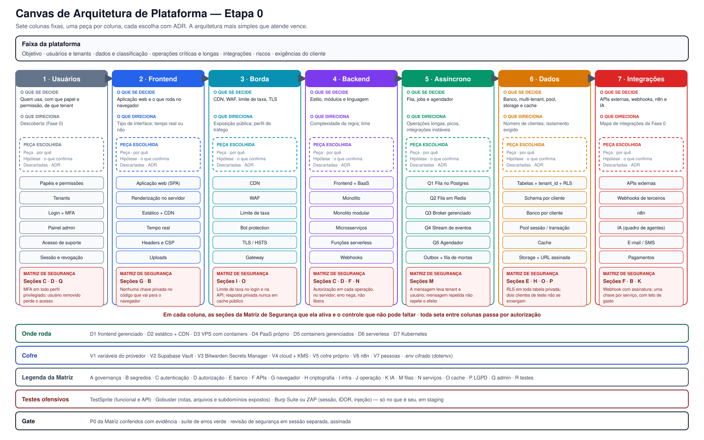

# Framework de Plataformas

**Como planejo, construo, protejo, testo e opero plataformas web.** Do problema do cliente até a plataforma publicada, com a segurança dentro de cada fase, e não numa auditoria antes do deploy.

> **A arquitetura mais simples que atende vence. Toda escolha tem por quê, para quê e ADR. Todo controle de segurança precisa de evidência.**

O framework tem duas partes que funcionam juntas:

- **O framework de construção** ([`docs/`](docs/)): Etapa 0, as fases de 0 a 10, o catálogo de decisões de arquitetura e o canvas.
- **A Matriz de Segurança** ([`docs/seguranca/`](docs/seguranca/matriz-de-seguranca.md)): os controles, de A a R, que cada decisão de arquitetura ativa, com prioridade de P0 a P3 e mapeamento para OWASP e LGPD.

Para plataformas com agente de IA, o desenho do agente segue o [mp-ai-platform](https://github.com/mathpr9-code/mp-ai-platform), e a segurança da plataforma inteira segue a matriz daqui.

---

## Sumário

- [Como funciona](#como-funciona)
- [Princípios](#princípios)
- [Fases](#fases)
- [Etapa 0 e o canvas](#etapa-0-e-o-canvas)
- [Decisões de arquitetura](#decisões-de-arquitetura)
- [Matriz de Segurança](#matriz-de-segurança)
- [Testes ofensivos internos](#testes-ofensivos-internos)
- [Gate final](#gate-final)
- [Documentação completa](#documentação-completa)

---

## Como funciona

1. **Descobrir** o que a plataforma faz, para quem, com quais dados e o que não pode dar errado.
2. **Desenhar** antes de construir: estilo de arquitetura, comunicação, filas, dados, linguagem e onde roda, cada escolha com por quê, para quê e o que a direciona.
3. **Construir por fases**, com segurança em cada uma.
4. **Provar** com testes e com a Matriz de Segurança. Todo erro encontrado vira teste.
5. **Operar** com observabilidade, backup testado e plano de incidente.

Nenhuma peça de arquitetura é regra. Monolito, monolito modular, microsserviços, fila ou chamada direta são escolhas por plataforma, registradas em ADR.

## Princípios

| Princípio | Na prática |
| --- | --- |
| Secure by design | Riscos e requisitos de segurança levantados antes de implementar |
| Menor privilégio | Cada usuário, serviço, função, chave e integração recebe só o acesso necessário |
| Negar por padrão | Acesso negado até existir regra explícita que permita |
| Regra no servidor | O frontend melhora a experiência; backend e banco aplicam a segurança |
| Defesa em profundidade | Autenticação, autorização, banco, infraestrutura e monitoramento como camadas complementares |
| Minimização de dados | Coletar, guardar, transmitir e devolver só o necessário |
| Segredos fora do código e do navegador | Nenhum segredo privilegiado em frontend, Git, logs ou respostas |
| Evidência antes de declarar seguro | Cada controle tem teste ou evidência verificável |
| A arquitetura mais simples que atende | Complexidade só entra com motivo nomeado e ADR |
| Falhar fechado | Em erro, timeout ou estado inesperado, o sistema nega e registra |
| Todo erro vira teste | Falha encontrada entra na suíte e roda antes de toda publicação |

## Fases

```mermaid
flowchart LR
  E0[Etapa 0<br/>pasta, quadro, skills] --> F0[Fase 0<br/>descoberta, escopo, risco]
  F0 --> F1[Fase 1<br/>arquitetura e fronteiras de confiança]
  F1 --> F2[Fase 2<br/>dados e privacidade]
  F2 --> F3[Fase 3<br/>banco, roles, RLS]
  F3 --> F4[Fase 4<br/>autenticação e sessão]
  F4 --> F5[Fase 5<br/>backend e APIs]
  F5 --> F6[Fase 6<br/>segredos e criptografia]
  F6 --> F7[Fase 7<br/>frontend e headers]
  F7 --> F8[Fase 8<br/>infra e dependências]
  F8 --> F9[Fase 9<br/>testes e revisão]
  F9 --> G{{Gate final}}
  G --> F10[Fase 10<br/>produção e incidentes]
  F10 -->|erro vira teste| F9
```

Cada fase tem a sua parte da Matriz de Segurança. A segurança não espera a Fase 9: a Fase 9 só prova o que as anteriores construíram.

## Etapa 0 e o canvas

O projeto nasce como uma pasta no VS Code com o quadro dentro, nunca de um quadro em branco. Depois vêm o escopo, as skills, os questionamentos, a estrutura do repositório e os segredos. Por último, o desenho no **Canvas de Arquitetura de Plataforma**: sete colunas fixas (Usuários, Frontend, Borda, Backend, Assíncrono, Dados, Integrações) com o que cada uma decide e a segurança de cada coluna. Em cima, a faixa de confiança mostra onde o dado é só pedido e onde a regra é aplicada; embaixo, onde roda, cofre, Matriz ativada, testes ofensivos e gate.

O arquivo editável está em [`diagramas/canvas-plataforma.excalidraw`](diagramas/canvas-plataforma.excalidraw). Cada seta do quadro tem um ponto de autorização, e cada peça escolhida diz quais seções da matriz ela ativa. Ver [`docs/01-etapa-0.md`](docs/01-etapa-0.md) e [`docs/05-canvas-e-seguranca-por-decisao.md`](docs/05-canvas-e-seguranca-por-decisao.md).

## Decisões de arquitetura

Cada decisão tem um catálogo de opções, o que direciona a escolha e o risco de segurança que cada opção traz.

| Decisão | Opções | Seção |
| --- | --- | --- |
| Estilo | Frontend + BaaS, monolito, monolito modular, microsserviços, funções serverless | [3.1](docs/03-arquitetura.md) |
| Comunicação | Síncrona ou assíncrona, por operação | [3.2](docs/03-arquitetura.md) |
| Filas e jobs | Q1 fila no Postgres, Q2 fila em Redis, Q3 broker gerenciado, Q4 stream de eventos, Q5 agendador | [3.3](docs/03-arquitetura.md) |
| Multi-tenant | Tabelas compartilhadas com RLS, schema por cliente, banco por cliente; pool em modo sessão ou transação | [3.4](docs/03-arquitetura.md) |
| Dados, resiliência e cache | Validação em camadas, retry, disjuntor, idempotência, cache só depois de medir | [3.5 a 3.7](docs/03-arquitetura.md) |
| Linguagem e stack | Por fronteira, com padrão proposto | [3.8](docs/04-stack-e-onde-roda.md) |
| Onde roda | D1 frontend gerenciado a D7 Kubernetes | [3.9](docs/04-stack-e-onde-roda.md) |
| Cofre de segredos | V1 variáveis do provedor a V7 cofre de pessoas | [8.1](docs/08-segredos-e-criptografia.md) |

## Matriz de Segurança

A [matriz](docs/seguranca/matriz-de-seguranca.md) é o que transforma "está seguro" em evidência. Cada controle tem como verificar, prioridade, status, responsável e data.

| Seções | Quando se aplicam |
| --- | --- |
| A governança · B segredos · B.1 agentes de desenvolvimento · C autenticação · D autorização e multi-tenant · E banco e Supabase · F APIs · G frontend · H criptografia · I infraestrutura e cadeia de suprimentos · J operação | Sempre |
| K segurança de IA | Com IA |
| M filas e jobs | Com fila, worker ou agendador |
| N comunicação entre serviços | Com mais de um serviço, ou módulo com dado sensível |
| O cache, pool e tratamento de dados | Com cache, pool, importação ou exportação |
| P LGPD e direitos do titular | Com dado pessoal |
| Q acesso administrativo e suporte | Com painel admin ou acesso de suporte |
| R testes ofensivos internos | Antes do primeiro deploy público e a cada mudança de autenticação, API, domínio ou storage |

**Prioridades:** P0 bloqueia a publicação; P1 é corrigido antes do release ou mitigado por escrito; P2 e P3 entram no plano de melhoria.

**Cobertura mapeada:** OWASP Top 10:2025, OWASP API Security Top 10:2023, OWASP Top 10 para LLM (2026), OWASP Top 10 para aplicações agênticas (2026), OWASP MCP Top 10 e Resolução CD/ANPD nº 15/2024 (comunicação de incidente). A matriz diz onde cada item de cada lista é tratado, para que nada fique sem controle.

## Testes ofensivos internos

Antes que alguém de fora teste a plataforma, ela é atacada por dentro, com as ferramentas que um atacante usaria, sempre no que é seu ou com autorização escrita, em staging e com dado fictício.

| Ferramenta | Para quê |
| --- | --- |
| [Gobuster](https://github.com/OJ/gobuster) | Mapear o que está exposto sem querer: diretórios, arquivos (`.env`, `.git`, backup), subdomínios, virtual hosts e buckets |
| [TestSprite](https://www.testsprite.com/) | Testes automatizados com IA de UI, API e ponta a ponta, ligados ao editor por MCP |
| [Burp Suite](https://portswigger.net/burp) ou [ZAP](https://www.zaproxy.org/) | Teste manual e DAST de autorização, sessão e injeção: trocar IDs, repetir requisição com outro token, mexer em campos privilegiados |

Todo achado vira caso na suíte de erros antes da correção. Ver [`docs/10-testes-e-gate.md`](docs/10-testes-e-gate.md), seção 11.2, e a seção R da matriz.

## Gate final

Nada vai para produção sem a revisão de segurança assinada, feita em sessão separada da construção, sem o agente de código que escreveu o projeto. A revisão traz nome, data, versão e cada controle P0 conferido com evidência. Ver [`docs/10-testes-e-gate.md`](docs/10-testes-e-gate.md).

## Documentação completa

| # | Documento | O que cobre |
| --- | --- | --- |
| 00 | [Como funciona](docs/00-como-funciona.md) | os cinco movimentos e os princípios |
| 01 | [Etapa 0](docs/01-etapa-0.md) | do VS Code ao quadro, legenda, sequência de passos |
| 02 | [Descoberta](docs/02-descoberta.md) | Fase 0: escopo, dados, risco |
| 03 | [Arquitetura](docs/03-arquitetura.md) | Fase 1: estilo, comunicação, filas, banco e multi-tenant, dados, resiliência, cache |
| 04 | [Stack e onde roda](docs/04-stack-e-onde-roda.md) | linguagem, padrão de stack, peças de deploy e provedores conferidos |
| 05 | [Canvas e segurança por decisão](docs/05-canvas-e-seguranca-por-decisao.md) | o quadro, a ordem de montagem e os controles que cada escolha ativa |
| 06 | [Dados, banco e RLS](docs/06-dados-banco-e-rls.md) | Fases 2 e 3 |
| 07 | [Autenticação e APIs](docs/07-autenticacao-e-apis.md) | Fases 4 e 5 |
| 08 | [Segredos e criptografia](docs/08-segredos-e-criptografia.md) | Fase 6, cofres, API keys, .env cifrado |
| 09 | [Frontend e infraestrutura](docs/09-frontend-e-infraestrutura.md) | Fases 7 e 8, controles para agentes de desenvolvimento |
| 10 | [Testes e gate](docs/10-testes-e-gate.md) | Fase 9, suíte de erros, testes ofensivos internos, gate final |
| 11 | [Produção e IA](docs/11-producao-e-ia.md) | Fase 10 e regras para agentes de IA |
| 12 | [Entregáveis](docs/12-entregaveis.md) | o que cada plataforma guarda |
| — | [Matriz de Segurança](docs/seguranca/matriz-de-seguranca.md) | controles A–R, cobertura OWASP e ANPD |
| — | [Fontes](docs/fontes.md) | documentação oficial usada nas decisões |

---

**Autor:** Matheus Pereira Ribeiro · [LinkedIn](https://www.linkedin.com/in/matheuspereiraribeiro) · [GitHub](https://github.com/mathpr9-code)

A matriz organiza controles técnicos e não substitui orientação jurídica.
