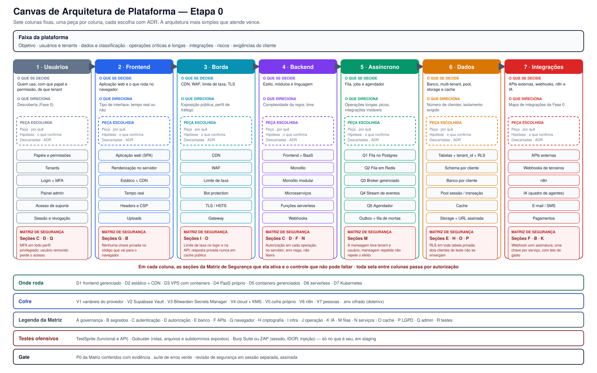

# Etapa 0 — do VS Code ao quadro

> 📐 A Etapa 0 é a mesma para plataforma e para agente, e começa sempre pelo quadro. O projeto nasce como uma pasta no VS Code com o arquivo do quadro dentro. Depois vem o escopo, as skills, os questionamentos, as pastas e, por último, o desenho da arquitetura no quadro. Nunca se parte de um quadro em branco.

## Arquivo do quadro (template)

O template do quadro está em [`diagramas/canvas-plataforma.excalidraw`](../diagramas/canvas-plataforma.excalidraw), renderizado abaixo.

Copie o arquivo para `docs/architecture/diagrams/canvas-plataforma.excalidraw` em cada projeto. Se a plataforma tiver um agente de IA, copie também o quadro de agentes do [mp-ai-platform](https://github.com/mathpr9-code/mp-ai-platform).

Como abrir: no VS Code, com a extensão Excalidraw (`pomdtr.excalidraw-editor`), o arquivo `.excalidraw` abre direto como quadro editável e continua sendo JSON versionado no Git. Fora do VS Code, abre em [excalidraw.com](http://excalidraw.com) pelo menu Abrir.

## Legenda do quadro

A letra diz o tipo de peça; o número é só a posição no catálogo. A mesma legenda está no rodapé do quadro.

| Código | Tipo de peça | Coluna ou faixa | Detalhe |
| --- | --- | --- | --- |
| Q1 a Q5 | Fila e jobs | 5 Assíncrono | Seção 3.3 |
| D1 a D7 | Deploy, onde roda | Faixa Onde roda | Seção 3.9 |
| V1 a V7 | Cofre de segredos | Faixa Transversal | Seção 8.1 |
| A a R | Seção da Matriz de Segurança | Faixa Segurança e faixa Matriz ativada | Matriz de Segurança |

| Código | O que é |
| --- | --- |
| Q1 | Fila no próprio banco (Postgres) |
| Q2 | Fila em Redis, com retry, atraso e prioridade |
| Q3 | Broker gerenciado do provedor de nuvem |
| Q4 | Stream de eventos, reprocessável |
| Q5 | Agendador de tarefas por horário |
| D1 | Hospedagem gerenciada de frontend |
| D2 | Estático em storage com CDN |
| D3 | VPS ou Droplet com containers e proxy |
| D4 | PaaS auto-hospedado (Coolify, Dokploy) |
| D5 | Containers gerenciados |
| D6 | Funções na borda ou serverless |
| D7 | Orquestrador de containers (Kubernetes) |
| V1 | Variáveis do provedor de hospedagem |
| V2 | Cofre no banco (Supabase Vault) |
| V3 | Gerenciador de segredos como serviço |
| V4 | Secret manager da nuvem, com KMS |
| V5 | Cofre próprio, com segredos dinâmicos |
| V6 | Credenciais do orquestrador (n8n) |
| V7 | Cofre de pessoas (gerenciador de senhas) |

Seções da Matriz citadas no quadro: A governança e desenho seguro; B chaves, credenciais e segredos; B.1 agentes de desenvolvimento; C identidade, autenticação e sessão; D autorização, papéis e multi-tenant; E banco de dados e Supabase; F APIs, entradas e respostas; G frontend, navegador e cookies; H criptografia e privacidade; I infraestrutura e cadeia de suprimentos; J operação, monitoramento e recuperação; K segurança de IA; M filas e jobs; N comunicação entre serviços e módulos; O cache, pool e tratamento de dados; P LGPD e direitos do titular; Q acesso administrativo e suporte; R testes ofensivos internos. A letra L é o resultado da avaliação, não um grupo de controles.

As peças das colunas 1 Usuários, 2 Frontend, 3 Borda, 4 Backend, 6 Dados e 7 Integrações aparecem por nome, sem código; o que cada uma significa está nas seções 3.1, 3.4 e 3.10.

## A sequência

| Passo | O que acontece | Quem | Sai daqui |
| --- | --- | --- | --- |
| 0.1 Pasta e quadro | Criar a pasta do projeto, abrir no VS Code, copiar o template para `docs/architecture/diagrams/` | Responsável | Pasta versionada no Git com o quadro dentro |
| 0.2 Escopo | Dizer o que é o projeto e se terá agente de IA (dois quadros). Preencher a faixa da plataforma em rascunho | Responsável | Faixa da plataforma; `PRODUCT.md` v0 |
| 0.3 Skills | Instalar as skills do Matt e rodar `/setup-matt-pocock-skills`; acrescentar skills próprias (por exemplo `pre-deploy-check`) | Responsável mais agente de código | Skills instaladas; bloco "Agent skills" no `CLAUDE.md`/`AGENTS.md`; `docs/agents/` |
| 0.4 Questionamentos | Rodar `/grill-me` (ou `/grill-with-docs`) sobre o escopo, cobrindo o que a Fase 0 pede: dados, papéis, operações críticas, operações longas, integrações, riscos | Agente pergunta, responsável e cliente respondem | `docs/discovery/`; vocabulário em `CONTEXT.md` |
| 0.5 Pastas | Criar a estrutura do repositório e exportar este framework e a Matriz para `docs/`; configurar os segredos: projeto no gerenciador de segredos, `.env` cifrado com dotenvx e `.env.keys` fora da pasta (seção 8.1) | Agente de código, com o responsável nos segredos | Árvore de pastas; `CLAUDE.md` apontando para os documentos; `.env` cifrado no Git e inventário de segredos sem valores |
| 0.6 Dados | Classificar os dados (Fase 2) e montar o inventário de segredos (8.1) | Responsável mais agente | `docs/sources/`, inventário de segredos sem valores |
| 0.7 Desenho | O agente preenche o quadro com o prompt da seção 3.10; o responsável abre, move as caixas e corrige | Agente desenha, responsável aprova | Quadro com uma peça por coluna, onde roda, Matriz ativada, segurança por coluna e setas com ponto de autorização; `docs/architecture/canvas.md` |
| 0.8 Registro | Um ADR por escolha material; plano por fases | Agente | `docs/architecture/decisions/`, `docs/plans/` |
| 0.9 Testes antes do código | Testes de isolamento entre tenants e os testes de arquitetura da seção 11.1 que as peças escolhidas exigem | Agente | `tests/`, `tests/error_suite/` |
| 0.10 Gate | Revisão do dono e do revisor de segurança, com a Matriz | Responsável, em duas sessões | `docs/plans/gate-0.md` assinado |

Por que nessa ordem: o escopo decide qual quadro entra; as skills vêm antes dos questionamentos porque o `/grill-me` é uma delas; os questionamentos definem o vocabulário e o conteúdo das pastas; o desenho vem por último porque estilo, fila, banco e deploy dependem do que foi descoberto sobre dados e operações.

Alinhamento com o setup do Matt: no `/setup-matt-pocock-skills`, responda com o issue tracker do projeto (ou arquivos locais) e com `CONTEXT.md` como documento de vocabulário de domínio.

As fases seguintes (Fase 0 a Fase 10) detalham cada passo. A Etapa 0 corresponde às Fases 0 e 1 deste documento.
